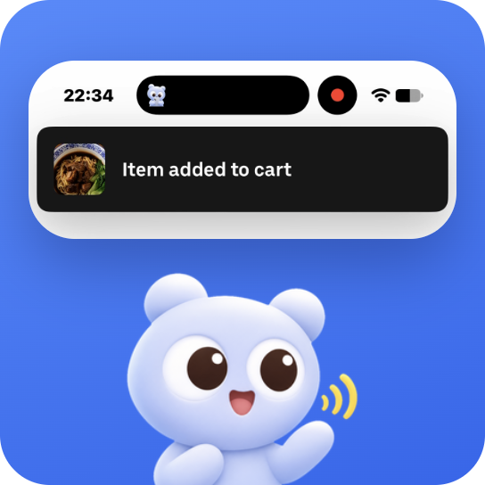

<p align="center">
  <a href="https://poki.bot"></a>
</p>

<h3 align="center">Bu istemi kopyalayıp kodlama ajanınıza gönderin</h3>

```text
Install Poki on my iPhone from https://github.com/JosssphZhou/poki
```

<p align="center"><sub>Önce iPhone'unuzu USB ile bağlayın ve kilidini açın. Ücretsiz bir Apple Hesabı yeterlidir.</sub></p>

<!-- badges:start -->
<p align="center">
  <a href="https://github.com/JosssphZhou/poki/stargazers"></a>
  <a href="https://github.com/JosssphZhou/poki/releases"></a>
  
  <a href="LICENSE"></a>
</p>
<!-- badges:end -->

<p align="center">
  <a href="README.md">English</a> | <a href="README.zh-CN.md">简体中文</a> | <a href="README.zh-TW.md">繁體中文</a> | <a href="README.ja.md">日本語</a> | <a href="README.ko.md">한국어</a> | <a href="README.es.md">Español</a> | Türkçe<br>
  <a href="https://poki.bot">poki.bot</a>
</p>

<p align="center">
  <strong>Poki işinize yarıyorsa projeyi desteklemek için ★ Star'a tıklayın.</strong>
</p>

## Poki Nedir?

Poki, tüm iPhone'unuzu sizin yerinize kullanan açık kaynaklı bir iPhone ajanıdır. Poki uygulaması doğrudan iPhone'unuzda çalışır, ekranı okur ve kendi model hesabınızı kullanarak gerçek uygulamaların içinde dokunur, yazar ve kaydırır. İzin isteme şeklini siz seçersiniz; ödemeler, silme işlemleri ve Cüzdan (Wallet) eylemleri her zaman onayınız için durur.

<p align="center">
  
</p>

## Neden Poki?

<p align="center">
  
  
  
</p>

- **Günlük işler için uygulamalar arasında dokunup durmaktan kurtulun.** Yerleşik tarayıcıda arama yapmak, yarının hava durumunu kontrol etmek veya not oluşturmak için sohbet üzerinden Poki'ye sorun, Eylem Düğmesini basılı tutun ya da Siri'yi tetikleyin. iPhone Duo'da Poki, Split View içinde yan yana iki uygulamada birden çalışır.
- **Kayıtlı becerileri dokunarak veya sesle çalıştırın.** Her gün aynı adımları tekrarlamak yerine ana ekrandan kayıtlı bir beceriyi başlatın veya Dynamic Island her adımı takip ederken Talk to Poki ile eller serbest sesli sohbet başlatın.
- **Bilgisayarı açık bırakmadan gerçek telefonunuzu otomatikleştirin.** Mac veya Windows PC üzerinden bir kez kurulduktan sonra Poki, bilgisayar bağlı olmadan iPhone'unuzda bağımsız olarak çalışır ve bir adım onay gerektirdiğinde Kilit Ekranında veya Dynamic Island'da duraklar.

## Nasıl Kullanılır?

### Poki'yi iPhone'unuza Kurun

1. **Mac veya Windows PC'den bir kez kurun.** iPhone'unuzu USB üzerinden bağlayıp kilidini açın (ücretsiz bir Apple Hesabı yeterlidir), ardından Claude Code veya Codex gibi kodlama ajanınıza şunu söyleyin:

   ```text
   Install Poki on my iPhone from https://github.com/JosssphZhou/poki
   ```

   Veya macOS (`.dmg`) ya da Windows (`.exe`) için [Poki Setup](https://github.com/JosssphZhou/poki/releases/tag/desktop-v0.2.9) uygulamasını indirip penceredeki adımları izleyin.
2. **Bağlanın ve model hesabınızı ekleyin.** **Güven (Trust)** seçeneğini onaylayın, iOS istediğinde Geliştirici Modunu (Developer Mode) ve Otomasyon Modunu (Automation Mode) açın, `10.7.0.1` adresini iPhone'unuza geri yönlendiren harici bir bağlantı (ücretsiz LocalDevVPN gibi) kurun ve ChatGPT Plus veya Pro ile giriş yapın ya da bir API anahtarı (Anthropic, OpenAI, Gemini, DeepSeek, OpenRouter, OpenCode Go veya OpenAI uyumlu bir sunucu) yapıştırın.
3. **İlk görevinizi çalıştırın.** Poki'yi açın ve şunu gönderin:

   ```text
   Create a new note in Notes titled "Poki Demo" with these three lines: Milk, Eggs, Coffee. Open the note when finished. Leave existing notes unchanged.
   ```

   Ardından Notlar uygulamasını açarak "Poki Demo" notunun bu üç satırla oluşturulduğunu doğrulayın.

iPhone uygulamasını Xcode ile derlemek ve imzalamak için [kodlama ajanları için kaynaktan kurulum istemini](docs/install-from-source-agent-prompt.md) kullanın.

<details>
<summary>Gereksinimler, güncelleme, sık sorulan sorular ve kılavuzlar</summary>

| | Gereksinim |
| --- | --- |
| iPhone | iOS 18 veya üzeri (iPhone XS, XR, SE 2. nesil veya daha yeni; iPad'de iPadOS 18+). iOS 27 yüklü fiziksel iPhone'larda test edilmiştir. |
| Bilgisayar | macOS 14+ yüklü Mac (ajan kurulumu için Node.js 24+) veya Apple Aygıtları ya da iTunes yüklü Windows PC (x64). |
| Kablo ve hesap | USB veri kablosu ve bir Apple Hesabı. Poki Setup açıkken ücretsiz 7 günlük imzaları yeniler veya Poki içinden giriş yapabilirsiniz. |
| Bağlantı | `10.7.0.1` adresini iPhone'a geri yönlendiren harici bağlantı (LocalDevVPN, Karing veya Shadowrocket). |
| Model hesabı | ChatGPT Plus/Pro oturumu, bir API anahtarı (Anthropic, OpenAI, Gemini, DeepSeek, OpenRouter, OpenCode Go) veya OpenAI uyumlu bir sunucu. |

- Ajan kurulum becerisi ve Poki Setup: [install-poki becerisi](skills/install-poki/SKILL.md) ve [Poki Setup](desktop/README.md)
- Doğrulama, sınırlar ve sürüm kanalları: [Doğrulama](docs/verification.md) ve [Sürüm kanalları](docs/release-channels.md)
- Önceki bilgisayar tabanlı araçlar (yalnızca güvenlik bakımı): [Poki MCP ve Poki Agent](docs/poki-mcp.md)

</details>

- Tam kurulum, güncelleme, SSS, bilinen sorunlar ve yol haritası: [Poki iPhone Uygulama Kılavuzu](docs/iphone-guide.md)
- Değişiklik günlüğü ve sürüm geçmişi: [CHANGELOG.md](CHANGELOG.md)

## Topluluk

- **Sorular ve fikirler:** [GitHub Discussions](https://github.com/JosssphZhou/poki/discussions) topluluğuna katılın.
- **Hatalar ve istekler:** [GitHub Issues](https://github.com/JosssphZhou/poki/issues) üzerinden konu açın.
- **Kod katkısı:** [CONTRIBUTING.md](CONTRIBUTING.md) dosyasını okuyun.
- **Davranış kuralları:** [CODE_OF_CONDUCT.md](CODE_OF_CONDUCT.md) kurallarına uyun.

Tüm katkıda bulunanları [CONTRIBUTING.md](CONTRIBUTING.md#contributors) dosyasında görebilirsiniz.

<br>

<p align="center"></p>

<p align="center"><sub>Copyright (c) 2026 Joseph Zhou (周瑟夫) ve katkıda bulunanlar. <a href="LICENSE">AGPL-3.0-only</a> lisansı altında açık kaynaklıdır. Marka varlıkları <a href="BRAND.md">BRAND.md</a> ile yönetilir. Bkz. <a href="docs/iphone-guide.md">Poki iPhone Uygulama Kılavuzu</a>, <a href="THIRD_PARTY_NOTICES.md">THIRD_PARTY_NOTICES.md</a> ve <a href="docs/iphone-guide.md#disclaimer">Sorumluluk Reddi</a>.</sub></p>
