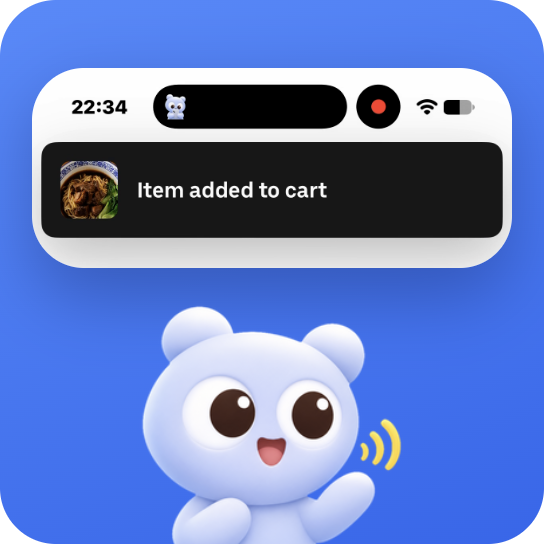
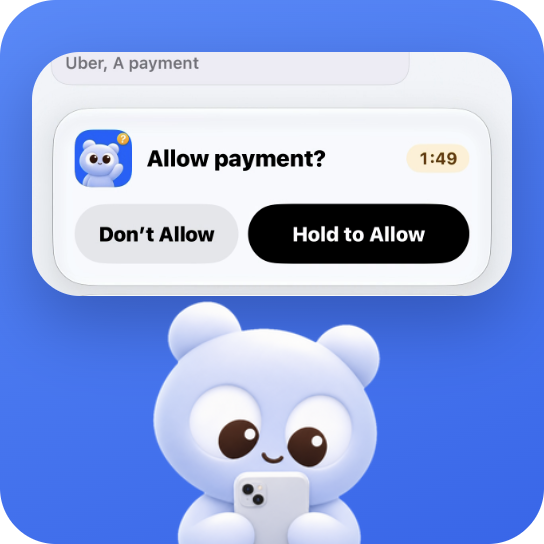

<p align="center">
  <a href="https://poki.bot"></a>
</p>

<h3 align="center">Sao chép câu lệnh này và gửi cho coding agent của bạn</h3>

```text
Cài đặt Poki lên iPhone của tôi từ https://github.com/JosssphZhou/poki
```

<p align="center"><sub>Trước tiên hãy kết nối iPhone qua USB và mở khóa máy. Tài khoản Apple miễn phí là đủ.</sub></p>

<!-- badges:start -->
<p align="center">
  <a href="https://github.com/JosssphZhou/poki/stargazers"></a>
  <a href="https://github.com/JosssphZhou/poki/releases"></a>
  
  <a href="LICENSE"></a>
</p>
<!-- badges:end -->

<p align="center">
  <a href="README.md">English</a> | <a href="README.zh-CN.md">简体中文</a> | <a href="README.zh-TW.md">繁體中文</a> | <a href="README.ja.md">日本語</a> | <a href="README.ko.md">한국어</a> | <a href="README.es.md">Español</a> | Tiếng Việt<br>
  <a href="https://poki.bot">poki.bot</a>
</p>

<p align="center">
  <strong>Nếu Poki hữu ích với bạn, hãy nhấn ★ Star để ủng hộ dự án.</strong>
</p>

## Poki là gì

Poki là một iPhone agent mã nguồn mở, thay bạn thao tác toàn bộ chiếc iPhone. Ứng dụng Poki chạy trực tiếp trên iPhone của bạn, đọc màn hình, rồi chạm, gõ và cuộn trong các ứng dụng thật bằng tài khoản mô hình của chính bạn. Bạn chọn cách Poki xin phép; các thao tác thanh toán, xóa dữ liệu và trong Wallet luôn dừng lại để chờ bạn xác nhận.

<p align="center">
  
</p>

## Vì sao chọn Poki

<p align="center">
  
  
  
</p>

- **Khỏi phải chạm qua nhiều ứng dụng cho những việc lặt vặt hằng ngày.** Chỉ cần nhắn cho Poki trong cuộc trò chuyện, giữ nút Tác vụ (Action Button), hoặc gọi Siri để tra cứu trong trình duyệt tích hợp, xem thời tiết ngày mai, hay tạo một ghi chú. Trên iPhone Duo, Poki làm việc đồng thời trong hai ứng dụng cạnh nhau ở chế độ Split View.
- **Chạy các kỹ năng đã lưu bằng một chạm hoặc bằng giọng nói.** Khởi chạy một kỹ năng đã lưu ngay từ màn hình chính thay vì lặp lại cùng các bước mỗi ngày, hoặc bắt đầu cuộc trò chuyện bằng giọng nói rảnh tay với Talk to Poki trong khi Dynamic Island theo dõi từng bước.
- **Tự động hóa chiếc điện thoại thật của bạn mà không cần máy tính luôn bật.** Sau khi cài đặt một lần từ máy Mac hoặc Windows PC, Poki chạy độc lập trên iPhone mà không cần gắn máy tính, và tạm dừng trên Màn hình khóa hoặc trong Dynamic Island mỗi khi một bước cần bạn phê duyệt.

## Cách sử dụng

### Cài đặt Poki lên iPhone của bạn

1. **Cài đặt một lần từ máy Mac hoặc Windows PC.** Kết nối và mở khóa iPhone qua USB (tài khoản Apple miễn phí là đủ), rồi nói với coding agent của bạn, chẳng hạn Claude Code hoặc Codex:

   ```text
   Cài đặt Poki lên iPhone của tôi từ https://github.com/JosssphZhou/poki
   ```

   Hoặc tải [Poki Setup](https://github.com/JosssphZhou/poki/releases/tag/desktop-v0.2.9) cho macOS (`.dmg`) hoặc Windows (`.exe`) và làm theo cửa sổ hướng dẫn.
2. **Kết nối và thêm tài khoản mô hình của bạn.** Chấp nhận **Tin cậy (Trust)**, bật Developer Mode và Automation Mode khi iOS yêu cầu, thiết lập một kết nối bên ngoài định tuyến `10.7.0.1` quay lại iPhone của bạn (chẳng hạn LocalDevVPN miễn phí), rồi đăng nhập bằng ChatGPT Plus hoặc Pro hoặc dán một API key (Anthropic, OpenAI, Gemini, DeepSeek, OpenRouter, OpenCode Go, hoặc một máy chủ tương thích OpenAI).
3. **Chạy tác vụ đầu tiên của bạn.** Mở Poki và gửi:

   ```text
   Tạo một ghi chú mới trong Notes với tiêu đề "Poki Demo" gồm ba dòng sau: Milk, Eggs, Coffee. Mở ghi chú khi hoàn thành. Không thay đổi các ghi chú hiện có.
   ```

   Sau đó mở Notes để xác nhận ghi chú "Poki Demo" tồn tại với ba dòng đó.

Để biên dịch và ký ứng dụng iPhone bằng Xcode, hãy dùng [câu lệnh cài đặt từ mã nguồn dành cho coding agent](docs/install-from-source-agent-prompt.md).

<details>
<summary>Yêu cầu, cập nhật, câu hỏi thường gặp và các hướng dẫn</summary>

| | Yêu cầu |
| --- | --- |
| iPhone | iOS 18 trở lên (iPhone XS, XR, SE thế hệ 2 hoặc mới hơn; iPadOS 18+ trên iPad). Đã kiểm thử trên iPhone thật chạy iOS 27. |
| Máy tính | Mac với macOS 14+ (Node.js 24+ nếu cài bằng agent) hoặc Windows PC (x64) có Apple Devices hoặc iTunes. |
| Cáp và tài khoản | Cáp dữ liệu USB và một tài khoản Apple. Poki Setup gia hạn chữ ký miễn phí 7 ngày trong khi đang mở, hoặc đăng nhập ngay trong Poki. |
| Kết nối | Kết nối bên ngoài định tuyến `10.7.0.1` quay lại iPhone (LocalDevVPN, Karing, hoặc Shadowrocket). |
| Tài khoản mô hình | Đăng nhập ChatGPT Plus/Pro, một API key (Anthropic, OpenAI, Gemini, DeepSeek, OpenRouter, OpenCode Go), hoặc một máy chủ tương thích OpenAI. |

- Kỹ năng cài đặt bằng agent và Poki Setup: [kỹ năng install-poki](skills/install-poki/SKILL.md) và [Poki Setup](desktop/README.md)
- Kiểm chứng, giới hạn và kênh phát hành: [Kiểm chứng](docs/verification.md) và [Kênh phát hành](docs/release-channels.md)
- Các công cụ điều khiển từ máy tính đời đầu (chỉ còn bảo trì bảo mật): [Poki MCP và Poki Agent](docs/poki-mcp.md)

</details>

- Cài đặt đầy đủ, cập nhật, FAQ, sự cố đã biết và lộ trình: [Hướng dẫn ứng dụng Poki cho iPhone](docs/iphone-guide.vi.md)
- Nhật ký thay đổi và lịch sử phiên bản: [CHANGELOG.md](CHANGELOG.md)

## Cộng đồng

- **Câu hỏi và ý tưởng:** Tham gia [GitHub Discussions](https://github.com/JosssphZhou/poki/discussions).
- **Lỗi và yêu cầu:** Mở một issue trong [GitHub Issues](https://github.com/JosssphZhou/poki/issues).
- **Đóng góp mã nguồn:** Đọc [CONTRIBUTING.md](CONTRIBUTING.md).
- **Quy tắc ứng xử:** Tuân thủ [CODE_OF_CONDUCT.md](CODE_OF_CONDUCT.md).

Xem tất cả người đóng góp trong [CONTRIBUTING.md](CONTRIBUTING.md#contributors).

<br>

<p align="center"></p>

<p align="center"><sub>Copyright (c) 2026 Joseph Zhou (周瑟夫) and contributors. Mã nguồn mở theo <a href="LICENSE">AGPL-3.0-only</a>. Tài sản thương hiệu tuân theo <a href="BRAND.md">BRAND.md</a>. Xem <a href="docs/iphone-guide.vi.md">Hướng dẫn ứng dụng Poki cho iPhone</a>, <a href="THIRD_PARTY_NOTICES.md">THIRD_PARTY_NOTICES.md</a>, và <a href="docs/iphone-guide.vi.md#tuyên-bố-miễn-trừ-trách-nhiệm">Tuyên bố miễn trừ trách nhiệm</a>.</sub></p>
